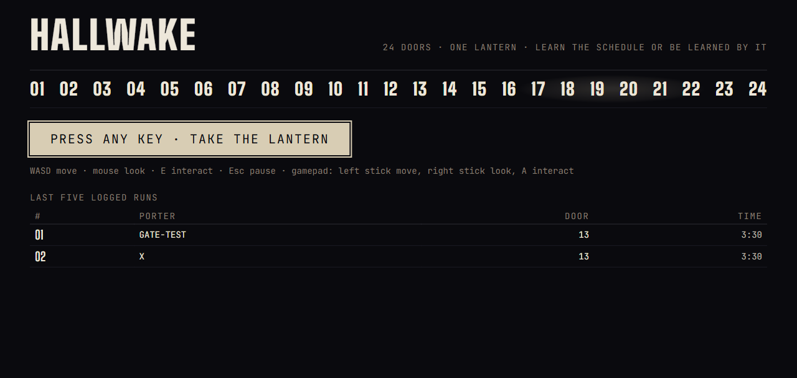
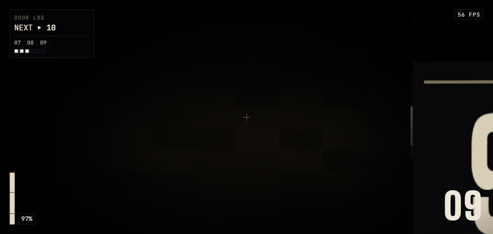
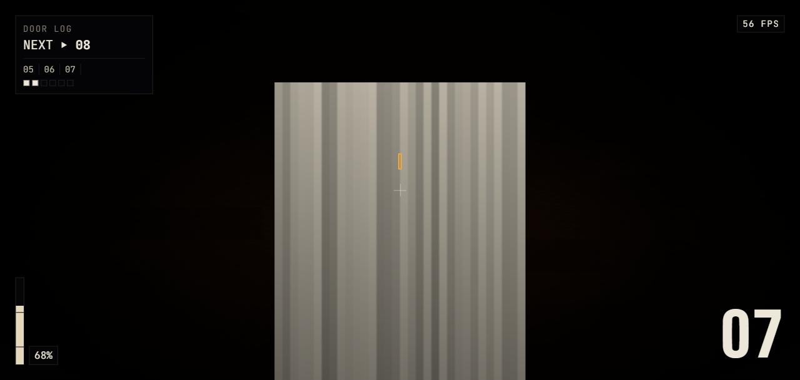

# HALLWAKE

**Learn the schedule — or be learned by it.**

HALLWAKE is a first-person horror corridor game that runs in the browser. You
are a night porter walking one floor of 24 numbered doors with a single
lantern and a fixed schedule of scares: four original entities — **GAUNT**
(sweeps the room when the lights burn amber), **MURMUR** (only moves in your
darkness), **TALLY** (edits the doors and spawns a fake one — the real door
always matches your HUD door log), **CINDER** (eats your lantern oil) — each
telegraphed by a readable tell before it strikes. There is no unreadable RNG:
every run is identical, so survival is knowledge, and the leaderboard rewards
knowledge, not dice. Built for the Cloud9 × JetBrains "Sky's The Limit"
hackathon, Category 3: a mini game playable at a Cloud9 booth — kiosk attract
loop, 30-second idle reset, six checkpoints, 3–5 minute sessions, local
leaderboard.

| Attract screen | Corridor HUD | GAUNT tell at door 7 |
|---|---|---|
|  |  |  |

## Quick start

Verified on this machine 2026-11-18 (proof tails: `deployment/README.md`).
Prereqs: Node 20+, Python 3.12+.

```powershell
# Windows PowerShell — builds dist/, starts backend (127.0.0.1:8401) + preview (127.0.0.1:8402)
.\deployment\start.ps1
# open http://localhost:8402   (or http://127.0.0.1:8402)
.\deployment\start.ps1 -Stop   # stop what it started
```

```bash
# Linux / macOS / Git Bash
./deployment/start.sh            # BACKEND_PORT / FRONTEND_PORT env to override
./deployment/start.sh --stop
```

Manual steps (exactly what the scripts do):

```powershell
# terminal 1 — backend (FastAPI + SQLite)
cd app\backend
python -m venv .venv
.venv\Scripts\pip install -r requirements.txt
.venv\Scripts\python.exe -m uvicorn main:app --host 127.0.0.1 --port 8401

# terminal 2 — frontend (Vite preview serves dist/ and proxies /api -> 8401)
cd app\frontend
npm ci
npm run build
npx vite preview --host 127.0.0.1 --port 8402
```

Two gotchas, both verified: always curl the backend as `http://127.0.0.1:8401`
(bare `vite preview` binds IPv6 `::1` on Windows), and keep the backend
loopback-only — the kiosk leaderboard is unauthenticated by design
(`qa/security.md` §7, `deployment/booth.md`).

The local LLM (vLLM, OpenAI-compatible, keyless) is **optional flavor only**:
if `HF_LLM_URL` is unreachable, `/health` shows `llm.online:false`, flavor
degrades to hand-authored canned lines, and the game is 100% playable and
fully scored. No paid API anywhere, in code or in this repo's history.

## Controls

- **Click** — lock the pointer / mouse look
- **WASD** — move
- **E** — interact (doors, sconces, alcoves, lore cards)
- **Gamepad** — left stick move, right stick look, A/X interact
- **Attract screen** — any key or button starts a run; 30 s idle returns to attract

Demo flags: `?auto=1` autopilot plays all 24 doors hands-free · `?fps=1` FPS
meter · `?quality=low|mid|high` pin a preset (default: auto-detect probes real
fps and steps down below 45 until it holds the 60 fps booth target).

## How it's built

- **Deterministic core** (`app/frontend/src/core/`): a pure TypeScript
  reducer, `stepSim(state, frame) -> state`, zero `Math.random`, zero
  THREE/DOM imports. Golden-trace tests replay hand-authored input sequences
  and assert identical state — the same schedule fires every run, which is
  what makes the demo reproducible and the leaderboard fair.
- **Render layer** (`src/render/`): raw Three.js (no react-three-fiber),
  fixed-timestep loop, merged static geometry, one lantern spotlight + ≤2
  event lights, zero shadow maps. Draw-call and light budgets are asserted by
  tests over every door × variant × quality combination.
- **Original by construction**: all textures are procedural canvas, all audio
  is WebAudio synthesis, all entity designs and names are coined for this
  project. A CI gate (`scripts/ip-check.sh`) greps shipped material for banned
  third-party terms and fails the build on any hit.
- **Backend** (`app/backend/`): FastAPI + stdlib SQLite — leaderboard
  (`/api/scores`, server-validated) and flavor proxy (`/api/flavor`) only.
  The game runs fully with the backend down (localStorage score mirror).
- **LLM firewall**: the local vLLM writes flavor only — lore cards, death
  epitaphs, run-card lines. Hard firewall: 0.8 s timeout, one request at a
  time, a busy slot never queues (it degrades to 32 canned lines per kind).
  LLM text is display-only DOM text, sanitized twice, never parsed back into
  game state. The sim never reads LLM output.

## Tests

```powershell
cd app\frontend
npm ci
npx vitest run                              # 999 tests / 13 files (verified 2026-11-18)

cd app\backend
.venv\Scripts\python.exe -m pytest -q       # 56 passed, 1 skipped (verified 2026-11-18)

bash scripts/ip-check.sh --selftest         # exit 0 = shipped material free of banned terms
```

CI (`.github/workflows/ci.yml`) runs all three on every push and PR.

## Tech stack

Vite 7 · React 19 · TypeScript 5.7 · Three.js 0.170 · zustand · vitest 5 ·
FastAPI · uvicorn · SQLite (stdlib) · GitHub Actions. Bundled fonts: Big
Shoulders, Courier Prime, JetBrains Mono — all SIL OFL
(`app/frontend/public/fonts/LICENSE-*.txt`).

## Repo map

```
app/frontend/   game: src/core (deterministic sim), src/render (Three.js),
                src/audio (WebAudio synth), src/ui (React HUD/kiosk screens)
app/backend/    FastAPI: /api/scores, /api/flavor, /health + tests
deployment/     start.ps1 / start.sh, booth LAN decision + patches, run recipe
scripts/        ip-check.sh — IP-safety CI gate
plan/ qa/       design contract, architecture, QA + security reports
presentation/   slides, spoken scripts, demo runbook, judge Q&A
submission/     deliverables checklist, project description, video script
```

## JetBrains tool use

The final implementation pass, refactors and codebase Q&A are done in
JetBrains tools: **WebStorm** (TypeScript game core), **PyCharm** (FastAPI
backend), **DataGrip** (SQLite schema), and **Junie** (AI coding agent) for
the AI-workflow methodology write-up. The `.idea/` and `.junie/` folders are
committed with the submission as the tool-use evidence the rules require —
that operator step is tracked in `submission/deliverables-checklist.md`.
JetBrains Mono is the product's instrument typeface — a nod, with zero
borrowed JetBrains brand assets.

## Methodology & QA

- Design contract: `plan/idea.md` · architecture: `plan/architecture.md`
  (+ `architecture.mmd`) · schedule: `plan/roadmap.md`
- QA: `qa/report.md` — 999 frontend + 56 backend tests green; browser gate:
  autopilot 24/24 doors, zero deaths, 57 fps, zero console errors
- Security: `qa/security.md` — zero open Critical/High findings
- Booth deployment: `deployment/README.md`, `deployment/booth.md`,
  `deployment/production-checklist.md`

## License

MIT — see [LICENSE](LICENSE). Bundled fonts are SIL OFL. No third-party game
assets, code, or audio of any kind are included.

## Credits

A solo entrant's project, built by driving the HackathonFactory multi-agent
pipeline (Claude Code) under operator direction, with human-gated browser QA,
security audit and integration checks. HALLWAKE, GAUNT, MURMUR, TALLY and
CINDER are original names coined for this project.
